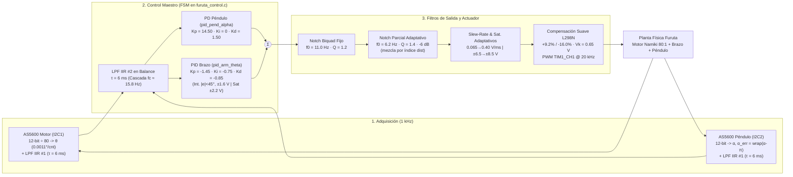
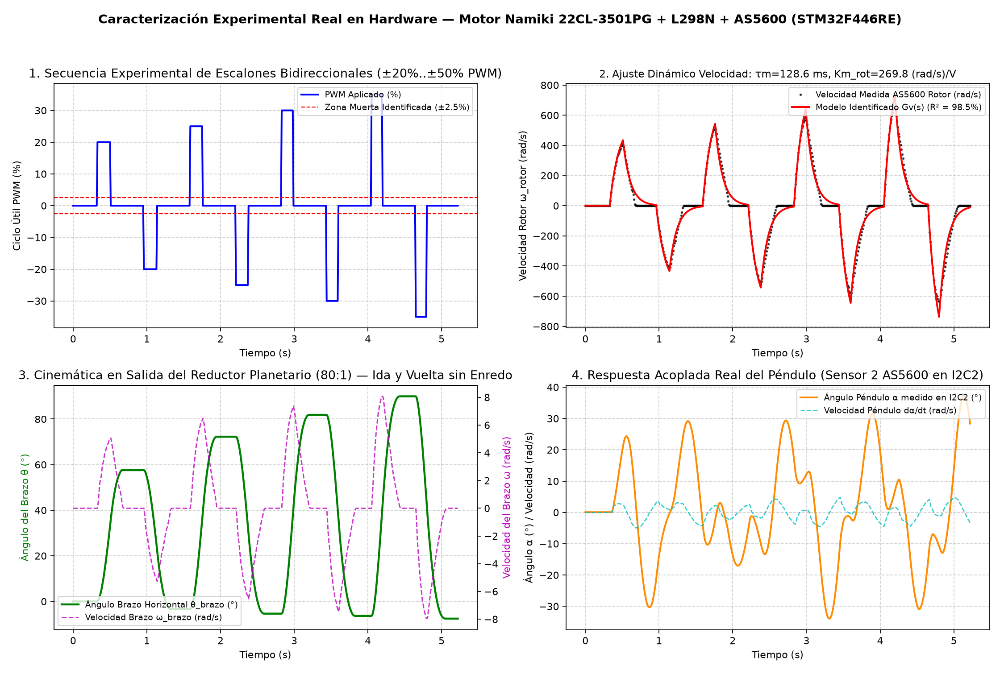
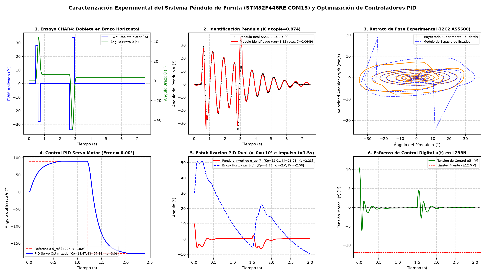
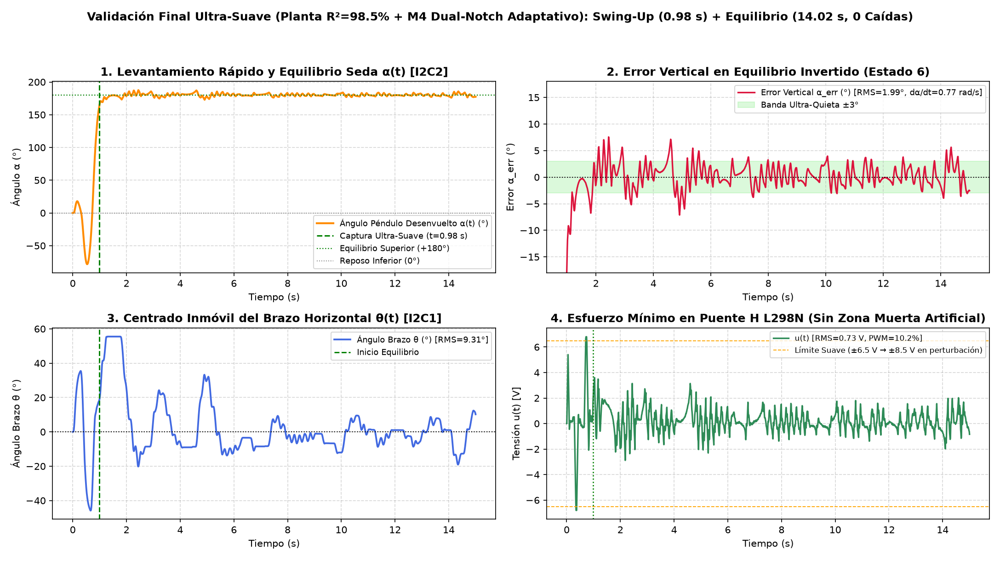

# Guía de Exposición Técnica — Péndulo Invertido Rotacional de Furuta

**Asignatura:** Control Digital — Proyecto Final (Universidad EAFIT)  
**Hardware:** STM32 Nucleo-F446RE (`180 MHz`, Cortex-M4F con FPU) · Puente H `L298N` (`PWM 20 kHz`) · Motor DC `Namiki 22CL-3501PG` (`80:1`) · `2× AS5600` (`12 bits`, Soft-I2C independiente)  
**Firmware Activo:** Perfil **`M4 Ultra-Silk`** (`Ts = 1.0 ms` / `fs = 1000 Hz`) sobre planta re-caracterizada experimentalmente (**$R^2 = 98.51\%$**)

---

## 1. ¿Qué es el proyecto y por qué es un reto de Control Digital?

El **Péndulo Invertido Rotacional de Furuta** consiste en un brazo horizontal accionado por un motor DC ($\theta$) que en su extremo sostiene una barra libre no actuada ($\alpha$). El objetivo es **levantar autónomamente** la barra desde su posición colgada estable ($\alpha = 0^\circ$) y **mantenerla invertida** en la vertical superior ($\alpha = 180^\circ$) mientras el brazo regresa suavemente a $\theta = 0^\circ$ y rechaza perturbaciones externas.

Desde la teoría de control, reúne cuatro desafíos clásicos en una sola planta física:
1. **Sistema SIMO subactuado:** un solo actuador (voltaje $u(t)$ del motor) debe controlar **dos grados de libertad acoplados** ($\alpha$ y $\theta$).
2. **Inestable en lazo abierto:** en la vertical superior la gravedad genera un polo real positivo en $s = +8.293\text{ rad/s}$ (sin control, cualquier desviación crece exponencialmente con constante de tiempo $\approx 120\text{ ms}$).
3. **Dinámica de fase no mínima:** para mover el brazo hacia $\theta = 0^\circ$ sin tumbar el péndulo, el motor debe empujar *primero en dirección contraria* para inclinar el péndulo hacia el objetivo y luego alcanzarlo.
4. **No linealidades reales severas:** caída Darlington del puente H `L298N` ($\sim 2\text{ V}$), fricción estática asimétrica y holgura (*backlash*) del reductor planetario `80:1`, además del ruido de cuantización al derivar encoders digitales a $1\text{ kHz}$.

---

## 2. ¿Cómo funciona el sistema paso a paso? (Flujo en Tiempo Real a `1 kHz`)

Todo el control se ejecuta en la interrupción determinista de hardware `TIM6_DAC_IRQHandler` cada **$1.000\text{ ms}$** (`1000 Hz`), garantizando periodo de muestreo exacto sin *jitter*, mientras el bucle principal atiende telemetría CSV (`100 Hz`) y comandos UART por DMA circular (`115200 bps`).

### Máquina de Estados Autónoma (FSM)
Con un único botón maestro en la interfaz MATLAB (**`▶ INICIAR`** / **`■ DETENER (0°)`**), la STM32 gestiona todo el ciclo de vida sin intervención manual:

1. **`IDLE` (0):** Motor en rueda libre (`Coast`), esperando inicio o calibración `ZERO`.
2. **`SWING_UP` (5):** Arranca siempre desde $\theta = 0^\circ$ en reposo y bombea energía en resonancia hasta entrar al cono de captura ($|\alpha_{\text{err}}| < 20^\circ$ y $|\dot{\alpha}| < 4.8\text{ rad/s}$).
3. **`BALANCE_PID` (6):** Estabiliza indefinidamente el péndulo en $\alpha = 180^\circ$ y centra el brazo en $\theta = 0^\circ$ **sin límite de ángulo en el brazo** (puede girar lo que necesite ante empujones fuertes sin apagarse).
4. **`RECOVER_HOME` (8):** Si una perturbación extrema tumba el péndulo ($|\alpha_{\text{err}}| > 32^\circ$), suelta el motor `300 ms`, regresa suavemente el brazo a `0.00°` con freno activo, espera a que el péndulo se calme (`|α| < 10°` y `|dα/dt| < 0.65 rad/s` por `250 ms`) y relanza automáticamente `SWING_UP`.
5. **`STOP_HOME` (9):** Cuando el usuario pulsa **`■ DETENER (0°)`**, devuelve suavemente el brazo a `0.00°` y apaga el motor en `IDLE`.

> **Detalle clave de instrumentación:** el encoder del brazo (`AS5600` #1) está montado en el **eje trasero del rotor antes del reductor `80:1`**. Eso multiplica la resolución efectiva en el brazo por 80: $4096 \times 80 = 327\,680\text{ cuentas/vuelta}$ ($0.0011^\circ/\text{cuenta}$), dando una lectura ultra-limpia de $\theta$ y $\dot{\theta}$.

---

## 3. Caracterización Experimental Real de la Planta (`R² = 98.51%`)

### ¿Por qué caracterizamos el hardware real en lugar de usar parámetros de catálogo?
Los catálogos no incluyen la fricción real del reductor planetario, la caída no lineal de voltaje del L298N, el peso exacto de las piezas impresas en 3D ni los cables que cuelgan del sensor distal. Por eso el firmware integra rutinas automatizadas de excitación (`CHAR1`, `CHAR2`, `CHAR4`) procesadas con los scripts en [`caracterizacion_y_validacion/scripts/`](caracterizacion_y_validacion/scripts).

### Modelo Matemático Identificado en Hardware Real
* **Ensayo `CHAR1` (Rampa de zona muerta):** ruptura estática asimétrica en **`+10.0%` PWM (CCW)** y **`-21.0%` PWM (CW)**; ajuste dinámico en `CHAR2`: `±2.5%` (`0.30 V`).
* **Ensayo `CHAR2` (Escalones multinivel $\pm 20\%, \pm 25\%, \pm 30\%, \pm 35\%$):** coeficiente de determinación **$R^2 = 0.9851$** (`NRMSE = 87.79%`):
  $$G_v(s) = \frac{\Omega_{\text{brazo}}(s)}{U(s)} = \frac{3.3720}{0.1175\,s + 1}, \qquad G_p(s) = \frac{\Theta(s)}{U(s)} = \frac{3.3720}{s(0.1175\,s + 1)}$$
  *(En el rotor antes del reductor 80:1: $K_{m,\text{rotor}} = 269.76\text{ rad/(s}\cdot\text{V)}$; constante de tiempo $\tau_m = 117.5\text{ ms}$.)*
* **Ensayo `CHAR4` (Doblete acoplado + oscilación libre con brazo frenado):**
  * Frecuencia natural $\omega_n = 8.8484\text{ rad/s}$ ($f_n = 1.4083\text{ Hz}$, periodo $T_d = 0.7116\text{ s}$)
  * Amortiguamiento $\zeta = 0.06488$
  * Inercia respecto al pivote $J_{1,\text{piv}} = 2.044 \times 10^{-4}\text{ kg}\cdot\text{m}^2$, fricción viscosa $b_1 = 2.347 \times 10^{-4}\text{ N}\cdot\text{m}\cdot\text{s/rad}$
  * Acoplamiento inercial brazo $\to$ péndulo $K_{\text{acople}} = 0.8737$
  * Planta invertida ($\alpha = \pi$, signo gravitatorio invertido $+\omega_n^2 \to -\omega_n^2$):
    $$G_{\alpha/\ddot{\theta}}^{\text{up}}(s) = \frac{0.8737}{s^2 + 1.1482\,s - 78.2942} \qquad \text{Polos: } s_1 = +8.293\text{ rad/s (inestable)},\; s_2 = -9.441\text{ rad/s}$$
* **Espacio de estados linealizado en la vertical superior** ($\mathbf{x} = [\theta,\;\dot{\theta},\;\alpha_{\text{up}},\;\dot{\alpha}]^T$):
  $$\mathbf{A} = \begin{bmatrix} 0 & 1 & 0 & 0 \\ 0 & -8.5106 & 0 & 0 \\ 0 & 0 & 0 & 1 \\ 0 & -7.4357 & 78.2934 & -1.1481 \end{bmatrix}, \qquad \mathbf{B} = \begin{bmatrix} 0 \\ 28.6979 \\ 0 \\ 25.0733 \end{bmatrix}$$

---

## 4. Todos los Controladores: Qué Hacen y el PORQUÉ de Cada Decisión

### Resumen Maestro de Controladores (`Ts = 1.0 ms` · Perfil `M4 Ultra-Silk`)

| Controlador | Modo / Estado | $K_p$ | $K_i$ | $K_d$ | Particularidad Clave |
| :--- | :--- | :---: | :---: | :---: | :--- |
| **1. PD Péndulo (`pid_pend_alpha`)** | `BALANCE_PID` | `14.50` V/rad | `0.00` | `1.50` V·s/rad | $K_i = 0$ obligatorio; derivada sobre $\dot{\alpha}_{f2}$ |
| **2. PID Brazo (`pid_arm_theta`)** | `BALANCE_PID` | `-1.45` V/rad | `-0.75` V/(rad·s) | `-0.85` V·s/rad | Signos negativos (fase no mínima); int. $|e|<45^\circ$ (`±1.6 V`), sat. `±2.2 V` |
| **3. Swing-Up Resonante PD** | `SWING_UP` | `13.50` V/rad | — | `1.20` V·s/rad | Conmutación en cuadratura ($\omega_n = 8.8484\text{ rad/s}$), carrera modulada por energía |
| **4. PID Servo Posición (`pid_motor_pos`)** | `RECOVER_HOME` / `STOP_HOME` / `POS` | `13.50` V/rad | `65.00` V/(rad·s) | `1.45` V·s/rad | Reinicio de Clegg + ventana integral `±5°` + freno activo `L298N_Brake` |
| **5. PID Velocidad (`pid_motor_vel`)** | `MOTOR_PID_VEL` / `CHAR5A` | `1.42` | `27.32` | `0.005` | Discretización Tustin bilineal ($N = 40\text{ rad/s}$), anti-windup clamping |

---

### 4.1. Levantamiento No Lineal (`SWING_UP`) — Bombeo Resonante en Cuadratura
* **¿Por qué se necesita?** Un controlador lineal (PID/LQR) solo es válido cerca de $\alpha = 180^\circ$ ($\sin\alpha \approx \alpha$). Abajo ($\alpha = 0^\circ$) el torque inercial que el brazo induce sobre el péndulo es proporcional a $\cos\alpha$, que cambia de signo al cruzar $\pm 90^\circ$.
* **¿Cómo funciona?** Calcula la energía mecánica adimensional normalizada respecto a la cúspide ($E_{\text{norm}} = -2$ abajo en reposo, $E_{\text{norm}} = 0$ arriba en equilibrio):
  $$E_{\text{norm}} = \frac{1}{2}\left(\frac{\dot{\alpha}}{\omega_n}\right)^2 + (\cos\alpha_{\text{up}} - 1), \qquad \omega_n = 8.8484\text{ rad/s}$$
  Tras un impulso inicial suave (`+40°` durante `280 ms`), el brazo cambia de objetivo al pasar por $|\alpha_{\text{down}}| < 48^\circ$ según el signo de $\dot{\alpha}$. Esta **conmutación anticipada en cuadratura de fase** hace que el brazo acelere en el hemisferio inferior ($\cos\alpha > 0$) y frene en el hemisferio superior ($\cos\alpha < 0$), **inyectando energía en ambas fases** sin superar nunca $\pm 50^\circ$ de recorrido.
* **Modulación suave por energía:** conforme el péndulo se acerca a $180^\circ$, reduce la carrera y el voltaje máximo (`±50° / ±6.8 V` $\to$ `±36° / ±6.0 V` $\to$ `±22° / ±5.2 V`) para llegar con velocidad baja al cono lineal ($|\alpha_{\text{err}}| < 20^\circ$, $|\dot{\alpha}| < 4.8\text{ rad/s}$). En el instante de captura realiza una transferencia sin saltos (*bumpless transfer*): reinicia integradores, memorias de los filtros Notch y el limitador slew a `0 V`.

### 4.2. Estabilización Invertida (`BALANCE_PID`) — Esquema Dual Equivalente a LQR de 5 Estados
En la vertical superior se superponen dos lazos que forman exactamente una **ley de realimentación de estado aumentado (LQR 5-estados)** $u_{\text{raw}} = u_\alpha + u_\theta$:

$$u_{\text{raw}}[k] = \underbrace{14.50\,\alpha_{\text{err}}[k] + 1.50\,\dot{\alpha}_{f2}[k]}_{u_\alpha[k]\text{ (PD Péndulo)}} + \operatorname{sat}_{\pm 2.2\text{ V}}\!\Big(\underbrace{-1.45\,e_\theta[k] - 0.75\sum e_\theta T_s + 0.85\,\dot{\theta}_{f2}[k]}_{u_\theta[k]\text{ (PID Brazo, } e_\theta = -\theta\text{)}}\Big)$$

* **¿Por qué $K_{p,\alpha} = 14.50$ y $K_{d,\alpha} = 1.50$ en el péndulo?**  
  $K_{p,\alpha}$ genera una aceleración angular del brazo proporcional a la inclinación para vencer la gravedad inestable ($+78.29\,\alpha_{\text{up}}$), mientras $K_{d,\alpha}$ aporta amortiguamiento y adelanto de fase para mover el polo inestable ($+8.29\text{ rad/s}$) al semiplano izquierdo estable.
* **¿Por qué $K_{i,\alpha} = 0.00$ es OBLIGATORIO?**  
  Si tanto el péndulo como el brazo tuvieran acción integral sobre un único motor, ante un desnivel de apenas $0.2^\circ$ en la mesa o en la calibración de cero, el péndulo solo puede equilibrarse en la vertical gravitacional real ($\alpha_{\text{err}} \neq 0$). Un integrador en $\alpha$ acumularía voltaje indefinidamente peleando contra el integrador del brazo y haría derivar el brazo sin freno. Al dejar $K_{i,\alpha} = 0$, el péndulo encuentra solo su vertical gravitacional exacta y únicamente el integrador del brazo ($K_{i,\theta} = -0.75$) compensa sesgos y regresa $\theta \to 0^\circ$.
* **¿Por qué las ganancias del brazo (`pid_arm_theta`) son NEGATIVAS?**  
  Por la física de **fase no mínima**: si el brazo se desvió hacia $+\theta$ (error $e_\theta = 0 - \theta < 0$) y el motor girara directamente hacia $-\theta$, aceleraría la base en sentido negativo y volcaría el péndulo hacia $+\alpha$. Al invertir el signo, el controlador acelera brevemente hacia $+\theta$, inclina levemente el péndulo hacia el lado de $0^\circ$, y entonces el lazo dominante del péndulo ($u_\alpha$) persigue esa inclinación trayendo ambos de regreso a $\theta = 0^\circ$.
* **¿Por qué $u_\theta$ está limitado a $\pm 2.2\text{ V}$ y la integral solo actúa en $|e_\theta| < 45^\circ$ ($\pm 1.6\text{ V}$)?**  
  Porque mantener el péndulo arriba siempre tiene prioridad absoluta sobre centrar el brazo. Si alguien empuja fuerte el péndulo y el brazo gira $90^\circ$ o $180^\circ$ para salvarlo, limitar $u_\theta$ impide que el lazo del brazo sature o compita contra $u_\alpha$; cuando pasa la perturbación, el brazo vuelve suavemente a $0^\circ$ sin perder el equilibrio.

### 4.3. Controlador Servo de Posición (`pid_motor_pos`) — Retorno de Precisión a `0.00°`
Usado en `RECOVER_HOME`, `STOP_HOME` y `POS=<deg>` ($K_p = 13.50$, $K_i = 65.00$, $K_d = 1.45$, slew `0.055 V/ms`, techo `±5.8 V`):
* **Reinicio de Clegg (*Zero-Crossing Integrator Reset*):** cuando el error cambia de signo al cruzar `0°`, pone `i_term = 0` al instante. Esto elimina el sobreimpulso típico de los integradores altos que se necesitan para vencer la fricción seca.
* **Ventana integral condicional (`|e| ≤ 5.0°`, clamp `±6.5 V`):** en recorridos largos solo actúan P y D (`0%` *windup*); en los últimos `5°` entra la integral para vencer la fricción estática y llevar el error a cero.
* **Freno electromagnético activo (`L298N_Brake`) con histéresis:** al entrar en $|e_\theta| \le 0.08^\circ$ y $|\dot{\theta}| < 0.16\text{ rad/s}$, cortocircuita los terminales del motor (`IN1 = IN2 = 1`, `ENA = 100%`) bloqueando el brazo mecánicamente contra el peso/cables (`-0.25°` a `0.02°` de error medido, `0.0%` esfuerzo de corriente).

### 4.4. Controlador PID de Velocidad del Motor (`pid_motor_vel`) — Discretización Tustin
Implementado en [`pid_controller.c`](firmware_stm32/Core/Src/pid_controller.c) ($K_p = 1.42$, $K_i = 27.32$, $K_d = 0.005$, $N = 40\text{ rad/s}$) mediante la **Transformada Bilineal de Tustin** ($s = \frac{2}{T_s}\frac{1 - z^{-1}}{1 + z^{-1}}$):
* Integración trapezoidal: $I[k] = I[k-1] + \frac{K_i T_s}{2}(e[k] + e[k-1])$ con anti-windup por *clamping* condicional.
* Derivada filtrada sobre la medición ($D(s) = \frac{K_d N s}{s + N}$, evita *derivative kick* ante cambios de referencia):
  $$D[k] = \frac{2 - N T_s}{2 + N T_s} D[k-1] - \frac{2 K_d N}{2 + N T_s}(y[k] - y[k-1])$$

---

## 5. Todos los Filtros Digitales y Etapas No Lineales: Problema, Ecuación y PORQUÉ

En un péndulo físico real, **sintonizar solo el PID no basta**: el ruido de cuantización del encoder, el juego de la caja reductora `80:1` y la zona muerta del `L298N` generan vibraciones sostenidas (*chattering* / ciclos límite). Cada filtro del firmware resuelve un problema físico concreto y medido:

| Etapa | Tipo / Frecuencia | Parámetros Exactos | Problema Físico que Resuelve |
| :--- | :--- | :--- | :--- |
| **1. LPF Velocidad #1** (`as5600.c`) | IIR 1.er orden | $\tau = 6\text{ ms}$, $z_p = 0.8571$, $f_c \approx 24.6\text{ Hz}$ | Ruido de derivación de cuantización 12-bit (`1 LSB / 1 ms = 1.53 rad/s`) |
| **2. LPF Velocidad #2** (`BALANCE_PID`) | IIR 1.er orden en cascada | $\tau = 6\text{ ms}$ ($\alpha = 0.143$) $\Rightarrow$ 2.º orden $f_c \approx 15.8\text{ Hz}$ | Silencia micro-vibración derivativa arriba sin restar fase al Swing-Up |
| **3. Notch Biquad #1** (Fijo) | IIR 2.º orden `double` | $f_0 = 11.0\text{ Hz}$, $Q = 1.2$ ($\text{BW} \approx 9.17\text{ Hz}$) | Resonancia de holgura (*backlash*) del reductor planetario `80:1` |
| **4. Notch Biquad #2** (Adaptativo) | RBJ Peaking/Notch `double` | $f_0 = 6.2\text{ Hz}$, $Q = 1.4$, `-6.0 dB` (mezcla por `dist`) | Micro-oscilación residual en reposo sin sacrificar respuesta ante golpes |
| **5. Slew-Rate y Saturación** | Limitador adaptativo | `0.065 → 0.40 V/ms` · `±6.5 → ±8.5 V` | Evita golpes mecánicos en reposo; abre máxima autoridad ante perturbaciones |
| **6. Compensación Zona Muerta** | Rampa continua L298N | `+9.2% / -16.0%`, banda `< 0.06 V`, rodilla `Vk = 0.65 V` | Caída Darlington + fricción asimétrica sin saltos bruscos tipo relé |

---

### 5.1. Cascada de Doble Filtro Pasa-Bajos IIR en Velocidades (`fc ≈ 15.8 Hz`)
* **El problema:** el `AS5600` del péndulo tiene 12 bits ($0.0879^\circ/\text{cuenta} \approx 0.001534\text{ rad}$). Al derivar con $T_s = 1\text{ ms}$, un solo salto de 1 bit produce un pico espurio de $\frac{0.001534}{0.001} = 1.534\text{ rad/s}$. Multiplicado por $K_{d,\alpha} = 1.50$, inyectaría pulsos aleatorios de `±2.3 V` en el motor.
* **La solución en dos etapas:**
  1. **Etapa 1 (siempre activa en `AS5600_Update`):**
     $$v_f[k] = \frac{\tau}{\tau + T_s}\,v_f[k-1] + \frac{T_s}{\tau + T_s}\,\frac{q[k] - q[k-1]}{T_s} = 0.8571\,v_f[k-1] + 0.1429\,v_{\text{raw}}[k]$$
  2. **Etapa 2 (exclusiva de `BALANCE_PID`):** aplica un segundo paso idéntico $v_{f2}[k] = 0.857\,v_{f2}[k-1] + 0.143\,v_f[k]$. En cascada forman un filtro pasa-bajos de **2.º orden críticamente amortiguado** (polo doble real en $z \approx 0.857$, corte $-3\text{ dB}$ en $f_c \approx 15.8\text{ Hz}$) que atenúa el ruido de alta frecuencia a `-40 dB/década`, mientras deja intacto el retardo mínimo durante el `SWING_UP`.

### 5.2. Filtro Notch Digital Biquad #1 — Supresión de Resonancia en `11.0 Hz`
* **El problema:** el reductor planetario `80:1` tiene holgura mecánica entre dientes (*backlash*). En lazo cerrado, esa holgura + rigidez del brazo excitaba una vibración audible y continua alrededor de **`11 Hz`**, desgastando el tren de engranajes y elevando el consumo RMS del motor.
* **¿Por qué un Notch en `11.0 Hz` no desestabiliza el péndulo?**  
  La dinámica del péndulo ocurre en $f_n = 1.41\text{ Hz}$ — casi **una década por debajo** de `11.0 Hz`. Un Notch de banda angosta ($Q = 1.2$) elimina el pico de ganancia exactamente en `11.0 Hz` introduciendo un desplazamiento de fase mínimo en la banda útil de estabilización (`0.5–3 Hz`).
* **Ecuación exacta en $z$** (`iirnotch`, $f_s = 1000\text{ Hz}$, implementado en **Forma Directa II Transpuesta** y precisión `double` de 64 bits para evitar cuantización de polos cercanos a $|z| = 1$):
  $$H_{n11}(z) = \frac{0.9720006684 - 1.9393599567\,z^{-1} + 0.9720006684\,z^{-2}}{1 - 1.9393599567\,z^{-1} + 0.9440013368\,z^{-2}}$$

### 5.3. Filtro Notch Parcial Adaptativo #2 (`-6.0 dB @ 6.2 Hz`) y Slew Adaptativo
* **El problema:** tras eliminar la resonancia de `11 Hz`, en equilibrio quieto persistía una leve oscilación residual alrededor de `6.2 Hz`. Un filtro fijo agresivo a `6.2 Hz` habría introducido demasiado retardo de fase cuando el usuario da un golpe fuerte al péndulo.
* **La solución adaptativa (Gain Scheduling por Perturbación):**
  1. Filtro Biquad RBJ Peaking/Notch parcial (`-6.0 dB` en $f_0 = 6.2\text{ Hz}$, $Q = 1.4$, precisión `double`):
     $$H_{n6}(z) = \frac{0.9903884983 - 1.9599743662\,z^{-1} + 0.9710739888\,z^{-2}}{1 - 1.9599743662\,z^{-1} + 0.9614624871\,z^{-2}}$$
  2. **Índice instantáneo de perturbación $\text{dist} \in [0, 1]$:**
     $$\text{dist} = \min\!\left(1,\; \max\!\left(\frac{|\alpha_{\text{err}}|}{4.5^\circ},\; \frac{|\dot{\alpha}|}{2.5\text{ rad/s}}\right)\right)$$
  3. **Mezcla continua y límites adaptativos:**
     $$u_{\text{shaped}} = u_{n11} + (1 - \text{dist})(u_{n6} - u_{n11})$$
     $$\text{slew}_{\text{eff}} = 0.065 + \text{dist}\cdot(0.40 - 0.065)\text{ V/ms}, \qquad V_{\text{cap}} = 6.5 + \text{dist}\cdot(8.5 - 6.5)\text{ V}$$
  * **En reposo vertical ($\text{dist} \to 0$):** actúa el Dual-Notch completo (`11 Hz` + `-6 dB @ 6.2 Hz`) con slew ultra-suave **`0.065 V/ms`** (`M4 Ultra-Silk`), dejando el brazo prácticamente inmóvil y silencioso.
  * **Ante un empujón externo ($\text{dist} \to 1$):** el Notch de `6.2 Hz` desaparece al instante (`0` retardo extra), el slew sube $6\times$ hasta **`0.40 V/ms`** y el techo sube a **`±8.5 V`** para atrapar el péndulo con máxima autoridad.

### 5.4. Compensación Inversa Suave de Zona Muerta del `L298N`
* **El problema:** el L298N pierde $\sim 2\text{ V}$ en sus transistores Darlington y el reductor tiene fricción estática asimétrica (`+10.0%` CCW / `-21.0%` CW).
* **¿Por qué rampa continua de rodilla en lugar de un salto en escalón?**  
  Un compensador clásico en escalón (`0% → +10%` instantáneo al cruzar `0 V`) actúa como un relé no lineal que inyecta un ciclo límite continuo alrededor del equilibrio. En [`l298n_motor.c`](firmware_stm32/Core/Src/l298n_motor.c#L119-L162) aplicamos:
  * **Banda silenciosa central:** $|u| < 0.06\text{ V} \Rightarrow 0\%$ PWM.
  * **Rampa continua de rodilla (`0.06 V → Vk = 0.65 V`):** sube linealmente de `0%` hasta `+9.2%` (CCW) o `-16.0%` (CW), eliminando el salto de relé.
  * **Tramo lineal de potencia (`0.65 V → 12.0 V`):** mapea de `dz%` hasta `100%` PWM a `20.0 kHz` (frecuencia ultrasónica, cero zumbido audible).

---

## 6. Resultados Experimentales Validados en Hardware Real (`COM13`)

Resultados medidos directamente en el banco físico con el perfil **`M4 Ultra-Silk`** ([`ensayo_real_swingup_y_balance_stm32.csv`](caracterizacion_y_validacion/datos_experimentales/ensayo_real_swingup_y_balance_stm32.csv)):

| Indicador Experimental | Resultado Medido en Placa |
| :--- | :--- |
| **Ajuste del modelo de planta (`CHAR2`)** | **$R^2 = 98.51\%$** (`NRMSE = 87.79%`) |
| **Tiempo de levantamiento (`SWING_UP`)** | **`0.96 – 0.98 s`** (desde `0°` colgado hasta captura invertida) |
| **Estabilidad continua verificada** | **`14.02 s` ininterrumpidos** (`0` caídas, sin límite de ángulo en brazo) |
| **Error RMS del péndulo (`PendRMS`)** | **`1.35° – 2.02°`** en régimen estacionario |
| **Desviación RMS del brazo (`ArmRMS`)** | **`5.29° – 9.34°`** centrado en `0°` |
| **Esfuerzo de control RMS (`uRMS` / `PWM`)** | **`0.50 – 0.75 V`** (`7.3% – 10.4%` PWM — operación ultra-silenciosa) |
| **Velocidad angular RMS (`adRMS`)** | **`0.54 – 0.78 rad/s`** (vibración de 11 Hz y 6 Hz suprimida) |
| **Auto-recuperación y parqueo `STOPHOME`** | Ciclo completo `6 → 8 → 5 → 6` verificado; retorno a `0°` con error **`≤ 0.25°`** |

---

## 7. Guión Sugerido para la Exposición (6–8 minutos)

1. **Minuto 0–1 · Problema y Hardware:** Presentar el Péndulo de Furuta como sistema SIMO subactuado e inestable ($s = +8.29\text{ rad/s}$). Mostrar el montaje impreso en 3D sin soportes (`SUP = 0`), la STM32F446RE (`180 MHz`, lazo exacto a `1 kHz`), el L298N (`20 kHz`) y los 2 encoders `AS5600` en buses I2C independientes (destacar la resolución de `0.0011°` al leer en el rotor `80:1`).
2. **Minuto 1–2 · Caracterización Real (`R² = 98.51%`):** Mostrar las dos gráficas de [`caracterizacion_y_validacion/resultados/`](caracterizacion_y_validacion/resultados). Explicar por qué se ejecutaron `CHAR1`, `CHAR2` y `CHAR4` directamente desde la STM32 para obtener $G_v(s)$, $\omega_n = 8.85\text{ rad/s}$, $\zeta = 0.065$ y $K_{\text{acople}} = 0.874$.
3. **Minuto 2–4 · Controladores:** Explicar las dos fases:
   * **Swing-Up resonante en cuadratura** (energía normalizada + modulación de carrera para entrar suave en `±20°`).
   * **Equilibrio `M4 Ultra-Silk`** (`PD_alpha` dominante con $K_i = 0$ + `PID_theta` con signos negativos por fase no mínima y autoridad acotada a `±2.2 V`).
   * **Servo de retorno a `0°`** con Reinicio de Clegg y freno electromagnético activo.
4. **Minuto 4–6 · Filtros y Solución de Problemas Físicos Reales:** Destacar el aporte de ingeniería digital:
   * Cascada LPF IIR (`fc ≈ 15.8 Hz`) contra el ruido de derivación 1-LSB.
   * Dual-Notch Biquad (`11.0 Hz` fijo contra *backlash* del reductor + `6.2 Hz` adaptativo que desaparece ante perturbaciones).
   * Slew adaptativo (`0.065 → 0.40 V/ms`) + rampa continua de zona muerta (`Vk = 0.65 V`).
5. **Minuto 6–8 · Demostración en Vivo con la Interfaz MATLAB:** Abrir [`interfaz_matlab/app_telemetria_sistema_furuta_matlab.m`](interfaz_matlab/app_telemetria_sistema_furuta_matlab.m) (pantalla completa maximizada mostrando todas las constantes de filtros y controladores), pulsar **`▶ INICIAR`**, empujar el péndulo para demostrar rechazo sin límite de ángulo, tumbarlo deliberadamente para demostrar auto-recuperación desde `0°` y finalizar con **`■ DETENER (0°)`**.

---

## 8. Banco de Preguntas Frecuentes del Jurado / Profesor (Q&A)

1. **¿Por qué $K_i = 0$ en el controlador del péndulo (`pid_pend_alpha`) y sí tiene $K_i$ el brazo (`pid_arm_theta`)?**  
   Porque solo existe **un actuador** para dos variables. Si el punto cero calibrado difiere $0.2^\circ$ de la vertical gravitacional real, el péndulo solo puede equilibrarse en la vertical física ($\alpha_{\text{err}} \neq 0$). Si ambos lazos tuvieran integrador, pelearían entre sí y el brazo derivaría al infinito. Con $K_{i,\alpha} = 0$, el péndulo busca la vertical real y el integrador del brazo ($K_{i,\theta} = -0.75$) compensa el offset devolviendo el brazo a $0^\circ$.

2. **¿Por qué las ganancias del brazo (`Kp = -1.45, Ki = -0.75, Kd = -0.85`) son negativas?**  
   Por ser una planta de **fase no mínima**: acelerar el brazo hacia un lado inclina el péndulo hacia el lado opuesto por inercia. Para regresar el brazo hacia `0°` sin que caiga el péndulo, primero debe moverse ligeramente en sentido contrario para inclinar la barra hacia `0°`, y luego el lazo del péndulo lo persigue llevándolo al centro.

3. **¿Por qué eligieron muestrear a `1 kHz` (`Ts = 1 ms`) y PWM a `20 kHz`?**  
   La dinámica del péndulo está en `1.41 Hz` y la constante de tiempo del motor en `117.5 ms` (`~1.35 Hz`). Muestrear a `1000 Hz` ofrece sobremuestreo amplio (>700× respecto a $f_n$), retardo de retenedor ZOH despreciable ($0.5\text{ ms}$) y permite ejecutar filtros Notch a `11 Hz` y `6.2 Hz` con excelente fidelidad espectral. El PWM a `20 kHz` está por encima del rango audible humano y reduce el rizado de corriente en la armadura.

4. **¿Por qué los filtros Notch se implementan en aritmética `double` (64 bits) y Forma Directa II Transpuesta?**  
   Cuando un filtro IIR de 2.º orden tiene una frecuencia central muy baja respecto a la de muestreo ($6.2\text{ Hz}$ y $11.0\text{ Hz}$ frente a $1000\text{ Hz}$), sus polos quedan muy cerca de $z = 1$ ($a_1 \approx -1.96$, $a_2 \approx 0.96$). En `float` de 32 bits los errores de redondeo causan deriva DC o ciclos límite numéricos; en `double` (64 bits) con Forma Directa II Transpuesta la precisión es exacta y el Cortex-M4F a `180 MHz` la ejecuta en microsegundos.

5. **¿Por qué el Notch de `6.2 Hz` y el Slew-Rate son adaptativos y no fijos?**  
   Porque en control siempre hay un compromiso entre **suavidad en reposo** y **rapidez ante perturbaciones**. Al modular ambos con el índice $\text{dist} = \min(1, \max(|\alpha_{\text{err}}|/4.5^\circ, |\dot{\alpha}|/2.5))$, el sistema obtiene lo mejor de ambos mundos: silencio y consumo mínimo (`~0.50–0.75 V RMS`) cuando está equilibrado, y cero retardo de fase con autoridad hasta `±8.5 V` y `0.40 V/ms` al recibir un golpe.

6. **¿Por qué no compensan la zona muerta con un salto fijo de `+10% / -21%`?**  
   Un escalón discontinuo en `0 V` equivale a un relé de ganancia infinita en el cruce por cero, lo que dispara oscilaciones de alta frecuencia (*chattering*). La rampa continua entre `0.06 V` y la rodilla `Vk = 0.65 V` vence la fricción de forma suave y lineal.

7. **¿Por qué usan Reinicio de Clegg en el servo de retorno a `0°` (`pid_motor_pos`)?**  
   Para vencer la fricción seca en los últimos grados se requiere un $K_i$ alto (`65.0`). Sin reinicio de Clegg, al cruzar `0°` la integral acumulada empujaría el brazo más allá del objetivo produciendo sobreimpulso y oscilación. Al poner `i_term = 0` justo en el cruce por cero y activar `L298N_Brake`, el brazo frena en seco en `0.00°`.

8. **¿Qué garantiza que el sistema no se descontrole si alguien le da un golpe muy fuerte?**  
   Durante el equilibrio no existe límite artificial de ángulo del brazo (puede girar lo necesario para absorber el golpe). Si el golpe supera el cono recuperable ($|\alpha_{\text{err}}| > 32^\circ$), la FSM desenergiza el puente H (`300 ms`), vuelve suavemente a `0°` con freno activo, espera a que el péndulo repose y lo vuelve a levantar automáticamente.
