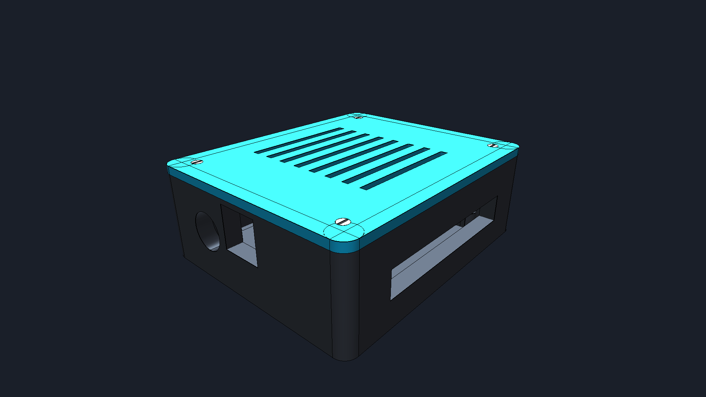
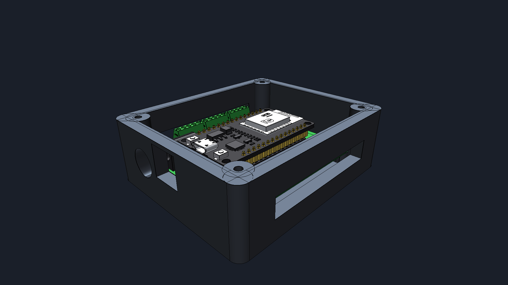
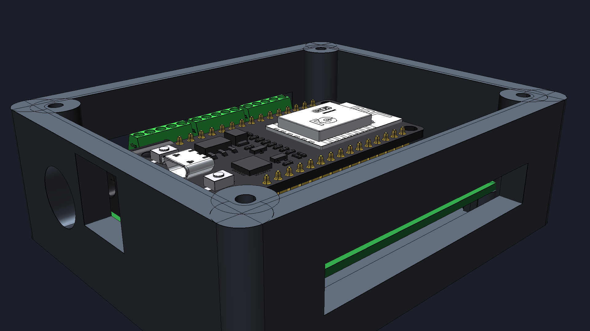
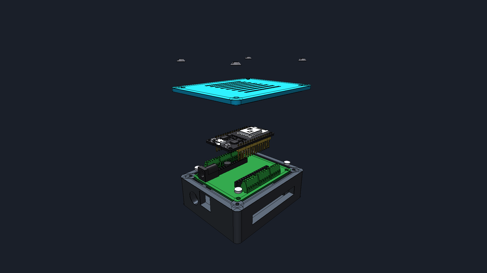
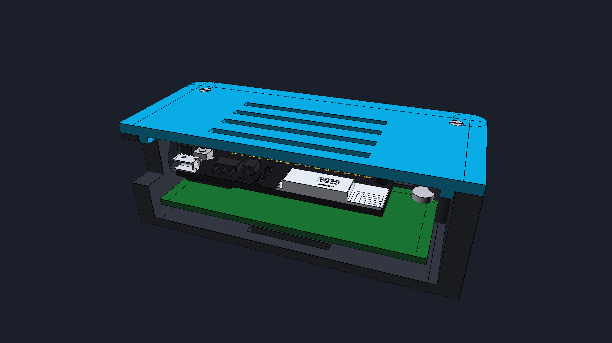
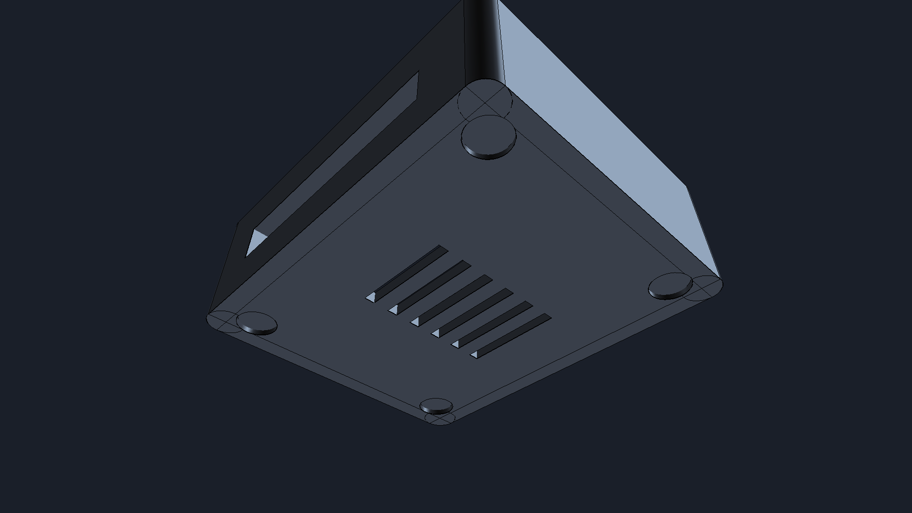

# Caja Protectora de Sobremesa para ESP32 con Placa de Expansión (FreeCAD 1.1)
## Rediseño Corregido: Puertos Frontales Lado a Lado y Ventanas Pasantes Completas

Se ha actualizado y regenerado en **FreeCAD 1.1** el modelo de la caja protectora para la electrónica de control del **Péndulo Invertido Rotacional de Furuta**, atendiendo a las especificaciones físicas de la tarjeta de expansión y su microcontrolador **ESP32 NodeMCU DevKit V1**:

1. **Puertos de Conectividad Lado a Lado en la Cara Frontal**:
   - El puerto de alimentación externa **Jack DC 2.1×5.5mm (DC-005)** se ha ubicado en la **misma pared frontal** que el conector **USB-C**, situados a una distancia entre ejes de $\Delta Y = 15.0\text{ mm}$ (USB-C a $Y = 0.0\text{ mm}$ y Jack DC a $Y = 15.0\text{ mm}$).
   - Un tabique intermedio de plástico macizo de $2.75\text{ mm}$ garantiza rigidez estructural entre ambos conectores, permitiendo enchufar simultáneamente el cable USB y el adaptador de pared sin interferencia mecánica.
2. **Orientación Coherente del ESP32**:
   - El módulo ESP32 se acopla en los zócalos hembra orientando su puerto USB hacia el frontal en alineación directa con la ventana de programación, situando la antena PCB RF hacia la pared posterior despejada de masa metálica.
3. **Aperturas Pasantes 100% Completas (Sin Membranas Ciegas)**:
   - Se ajustaron los límites de corte booleano: las ranuras laterales de salida de cables ($54.0\text{ mm} \times 8.5\text{ mm}$) y los puertos frontales atraviesan íntegramente los $3.0\text{ mm}$ del espesor de pared desde el interior de la cavidad hasta el exterior libre.

---

## 1. Galería de Renders Actualizada (Coin3D Offscreen 1080p)

---

## 2. Especificaciones de Encastre y Tolerancias de Fabricación

| Parámetro / Apertura | Cotas Nominales | Tolerancia & Justificación Mecánica |
|---|---|---|
| **Ventana Frontal USB-C** | $13.0\text{ mm} \times 13.0\text{ mm}$ (Centrada en $Y = 0$) | Abertura pasante total. Admite cables USB-C y Micro-USB con carcasas anchas. |
| **Puerto Jack DC de Potencia** | $\varnothing 11.5\text{ mm}$ pasante (Eje en $Y = 15.0$) | Coaxial con el zócalo DC-005 ($X = -33.0$). Admite clavijas $5.5 \times 2.1\text{ mm}$ y $5.5 \times 2.5\text{ mm}$. |
| **Separador entre Conectores** | $2.75\text{ mm}$ de tabique macizo | Evita debilitamiento del chasis y asegura aislamiento entre masa USB y retorno DC. |
| **Ranuras Laterales Borneras** | $54.0\text{ mm} \times 8.5\text{ mm}$ (Ambos costados) | Abertura pasante total desde cavidad interna ($Y = \pm 30$) a exterior ($Y = \pm 35$). |
| **Cavidad Interior Libre** | $74.0\text{ mm} \times 60.0\text{ mm} \times 24.4\text{ mm}$ | Holgura de $+3.0\text{ mm}$ en todo el perímetro de la PCB ($68.0 \times 54.0\text{ mm}$). |
| **Standoffs de Tarjeta** | 4 torretas $\varnothing 6.5\text{ mm}$, altura $5.0\text{ mm}$ | Elevan el PCB aislando soldaduras del fondo. Taladros $\varnothing 2.5\text{ mm} \times 6\text{ mm}$. |
| **Labio de Centraje de Tapa** | $73.5\text{ mm} \times 59.5\text{ mm} \times 1.8\text{ mm}$ | Holgura diametral de $0.5\text{ mm}$ ($0.25\text{ mm}$ radial) para cierre firme sin forzar. |
| **Rejilla Inferior / Superior** | 6 ranuras inferiores ($22 \times 2.4\text{ mm}$) / 8 superiores ($38 \times 2.2\text{ mm}$) | Convección vertical continua por efecto chimenea sobre el módulo ESP32. |

---

## 3. Archivos de Fabricación Disponibles

- [`Caja_ESP32_Expansion.FCStd`](Caja_ESP32_Expansion.FCStd) — Archivo maestro paramétrico en FreeCAD 1.1 con puertos lado a lado y modelos CAD reales.
- [`Caja_ESP32_Completa_Assembly.step`](Caja_ESP32_Completa_Assembly.step) — Ensamble completo universal para visualización y verificación (el `.stl` completo se puede regenerar localmente ejecutando `scripts/build_caja_esp32.py --with-huge-stl`).
- [`Caja_Base_ESP32.stl`](Caja_Base_ESP32.stl) | [STEP](Caja_Base_ESP32.step) — Base inferior lista para imprimir en 3D en PLA/PETG.
- [`Tapa_Caja_ESP32.stl`](Tapa_Caja_ESP32.stl) | [STEP](Tapa_Caja_ESP32.step) — Tapa desmontable con avellanados M3 y persiana convectiva.
- [`Placa_ESP32_Expansion_Real.step`](Placa_ESP32_Expansion_Real.step) — Hardware electrónico real ensamblado.
- [`GUIA_FABRICACION_CAJA_ESP32.md`](GUIA_FABRICACION_CAJA_ESP32.md) — Manual de impresión, parámetros slicer y conexionado.