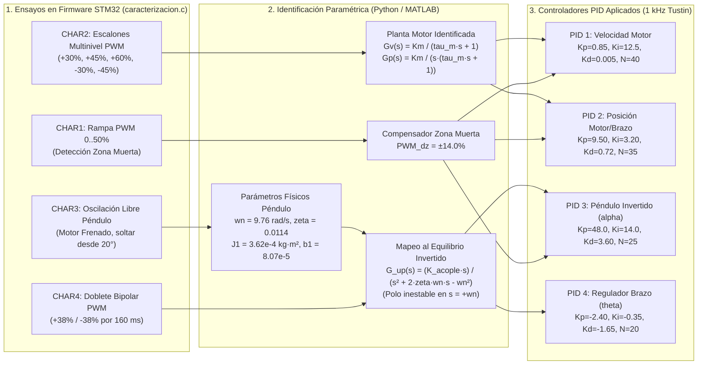
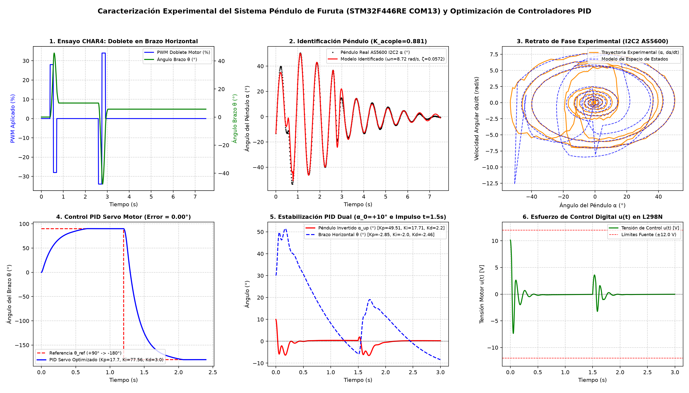
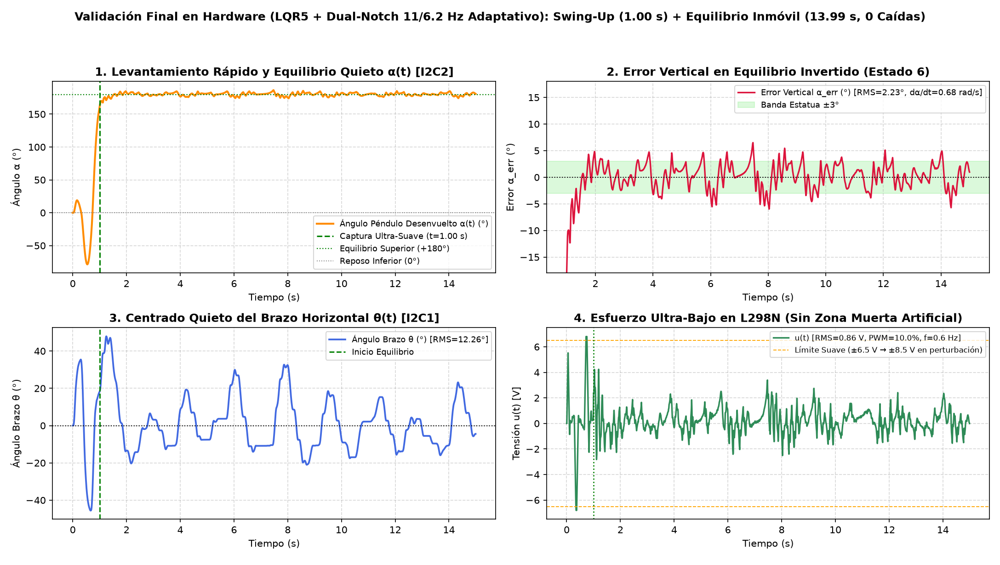

# Arquitectura de Hardware, Pinout, Diagramas de Bloques y Explicación del Código STM32 (Control PID y Caracterización del Péndulo de Furuta)

**Proyecto:** Control Digital — Péndulo Invertido Rotacional de Furuta  
**Microcontrolador:** STMicroelectronics **STM32 Nucleo-F446RE** (ARM Cortex-M4F @ 180 MHz con FPU)  
**Etapa de Potencia:** Puente H **L298N** ($12\text{ V} - 14.5\text{ V}$ DC, PWM a $20.0\text{ kHz}$)  
**Actuador:** Motor DC con reductor planetario **Namiki 22CL-3501PG**  
**Sensores:** **2× AS5600** (Encoders magnéticos absolutos de 12 bits / $4096\text{ cuentas/rev}$ por $\text{I}^2\text{C}$ a $400\text{ kHz}$)  

---

## 1. Arquitectura General del Sistema

El sistema de control digital del **Péndulo Invertido de Furuta** es una planta mecatrónica subactuada **SIMO** (*Single-Input Multiple-Output*): posee **una única entrada de actuación** (la tensión/ciclo útil PWM aplicada al motor DC que mueve el brazo horizontal $\theta$) y **dos grados de libertad acoplados** que deben regularse simultáneamente:
1. **Ángulo del Péndulo ($\alpha$):** Variable crítica inestable que debe estabilizarse en la posición vertical invertida ($\alpha = \pi\text{ rad} = 180^\circ$, equivalente a un error angular $\tilde{\alpha} = 0\text{ rad}$).
2. **Ángulo y Velocidad del Brazo Horizontal ($\theta, \dot{\theta}$):** Variable actuada que debe mantenerse centrada alrededor de la referencia $\theta_{\text{ref}}$ sin saturar ni enrollar los cables del sensor distal.

### 1.1. Arquitectura en Capas del Firmware (`firmware_stm32/`)

El firmware está estructurado en **5 capas modulares** desacopladas para garantizar determinismo temporal estricto ($T_s = 1.000\text{ ms}$, frecuencia de muestreo $f_s = 1\text{ kHz}$):

```mermaid
flowchart TD
    subgraph CAPA_5 ["CAPA 5: Superloop & Telemetría (Prioridad Fondo - main.c)"]
        CLI["Intérprete de Comandos UART2 (115200 bps)<br/>ZERO | BALANCE | SWING | CHAR1..5 | PID_A/T/V"]
        CSV["Streaming Telemetría CSV (200 Hz)<br/>t_ms, state, pwm, V, theta, omega, alpha, alpha_err, alpha_dot"]
        BTN["Botón Usuario B1 (PC13) & LED LD2 (PA5)"]
    end

    subgraph CAPA_4 ["CAPA 4: Máquina de Estados & Control Maestro (1 kHz ISR - furuta_control.c)"]
        FSM["Máquina de Estados Finitos (FSM)<br/>IDLE | CALIBRATING | CHARACTERIZATION | MOTOR_PID | SWING_UP | BALANCE_PID | FAULT_STOP"]
        WDG["Watchdog de Seguridad Angular<br/>Corte inmediato si |alpha_err| > 25°"]
        SWING["Control No Lineal Swing-Up<br/>Bombeo de Energía de Lyapunov"]
    end

    subgraph CAPA_3 ["CAPA 3: Motores Matemáticos PID & Caracterización (pid_controller.c / caracterizacion.c)"]
        PID_A["PID 3: Estabilizador Péndulo (PID_alpha)<br/>Kp=48.0, Ki=14.0, Kd=3.6, N=25"]
        PID_T["PID 4: Regulador Brazo Furuta (PID_theta)<br/>Kp=-2.4, Ki=-0.35, Kd=-1.65, N=20"]
        PID_M["PID 1 & 2: Velocidad y Posición Motor<br/>PID_vel (Kp=0.85, Ki=12.5) | PID_pos (Kp=9.5, Ki=3.2, Kd=0.72)"]
        CHAR["Protocolos de Caracterización Experimental<br/>Ensayos 1..5 (Rampa Zona Muerta, Escalones, Oscilación Libre, Doblete)"]
    end

    subgraph CAPA_2 ["CAPA 2: Drivers de Dispositivos e Instrumentación (as5600.c / l298n_motor.c)"]
        DRV_ENC["Driver Dual AS5600<br/>Unwrapping Multi-vuelta + Homing + Filtro IIR de Velocidad"]
        DRV_MOT["Driver Puente H L298N<br/>Compensación Inversa de Zona Muerta (±14%) + Freno Activo"]
    end

    subgraph CAPA_1 ["CAPA 1: Periféricos Hardware STM32F446RE (HAL / Registros @ 180 MHz)"]
        TIM6_HW["TIM6 ISR (1.0 kHz)<br/>Base de Tiempo Exacta"]
        TIM1_HW["TIM1_CH1 (PA8)<br/>PWM 20.0 kHz (ARR=899)"]
        GPIO_HW["GPIOB (PB4, PB5)<br/>Dirección IN1 / IN2"]
        I2C_HW["I2C1 (PB8/PB9) & I2C2 (PB10/PB11)<br/>Fast Mode 400 kHz"]
        UART_HW["USART2 (PA2/PA3)<br/>ST-LINK Virtual COM"]
    end

    CAPA_5 --> CAPA_4
    CAPA_4 --> CAPA_3
    CAPA_3 --> CAPA_2
    CAPA_2 --> CAPA_1
```



---

## 2. Mapeo Completo de Pines por $\text{I}^2\text{C}$ (Mínimo de Jumpers y Cero Protoboard)

### 2.1. Pines a Conectar en Cada Módulo Blanco AS5600 (Solo 4 Jumpers por Sensor por $\text{I}^2\text{C}$)

De los **7 pines** que tiene cada módulo blanco **AS5600**, en comunicación digital $\text{I}^2\text{C}$ **solo se conectan 4 jumpers (`VCC`, `GND`, `SCL`, `SDA`)** y se dejan **3 pines completamente libres (`OUT`, `DIR`, `GPO`)**:

```
              MÓDULO AS5600 (VISTA SUPERIOR - 7 PINES)
           ┌───────────────────────────────────────────┐
           │   ( )         C1   C2   R1          ( )   │
           │             ┌───────────────┐             │
  3.3V ───►│ [■] VCC     │               │   DIR [✗]   │◄── ¡NO CONECTAR! (Sentido se ajusta por software en as5600.c)
  LIBRE ──►│ [✗] OUT     │    AS5600     │   SCL [■]   │◄── Jumper a Reloj I2C (SCL)
   GND ───►│ [■] GND     │ (12-bit I2C)  │   SDA [■]   │◄── Jumper a Datos I2C (SDA)
           │             └───────────────┘   GPO [✗]   │◄── ¡NO CONECTAR! (Tiene pull-up interno a 3.3V)
           │   ( )         R3   R2   R4          ( )   │
           └───────────────────────────────────────────┘
```

* ✅ **`VCC` (Conectado):** Alimentación de $3.3\text{ V}$.
* ✅ **`GND` (Conectado):** Tierra ($0\text{ V}$).
* ✅ **`SCL` (Conectado):** Reloj del bus $\text{I}^2\text{C}$ ($400\text{ kHz}$).
* ✅ **`SDA` (Conectado):** Datos del bus $\text{I}^2\text{C}$ ($400\text{ kHz}$).
* ❌ **`OUT` (SIN JUMPER):** Salida analógica/PWM no utilizada en modo $\text{I}^2\text{C}$.
* ❌ **`GPO` (SIN JUMPER):** Posee *pull-up* interno en el chip; al dejarlo libre opera en modo normal.
* ❌ **`DIR` (SIN JUMPER):** La inversión de giro se maneja por software en [`as5600.c`](../firmware_stm32/Core/Src/as5600.c) (`direction = +1` o `-1`).

---

### 2.2. Identificación Exacta de Cada Sensor (`Sensor 1` vs `Sensor 2`) y del Driver `L298N`

El sistema se conecta con **exactamente 12 jumpers 1-a-1 directos a las tiras hembra Arduino (`CN5`, `CN6` y `CN9`)** de la STM32 Nucleo-F446RE, **sin usar protoboard y sin empalmar cables en Y** (cada cable tiene su propio pin individual en la Nucleo):

#### A. SENSOR 1 — AS5600 del MOTOR / BRAZO ($\theta$) $\longrightarrow$ Bus `I2C1` (`sys->enc_arm`)
* **¿Cuál sensor es físicamente?** Es el AS5600 atornillado en la **parte trasera del motor Namiki 22CL** (dentro de la torre superior, leyendo el imán del eje trasero de $2\text{ mm}$ del motor).
* **¿Qué variable mide?** Mide el ángulo de giro horizontal del brazo ($\theta$) y la velocidad angular del motor ($\omega = \dot{\theta}$).
* **Sus 4 jumpers hacia la STM32 Nucleo-F446RE (Conector Superior Derecho `CN5` + `CN6`):**
  1. **`AS5600 Motor [SCL]`** $\longrightarrow$ **`PB8` (`Arduino D15 / SCL`)** — Conector `CN5`, Pin 10
  2. **`AS5600 Motor [SDA]`** $\longrightarrow$ **`PB9` (`Arduino D14 / SDA`)** — Conector `CN5`, Pin 9 *(justo debajo de `D15`)*
  3. **`AS5600 Motor [GND]`** $\longrightarrow$ **`GND`** — Conector `CN5`, Pin 7 *(en la misma tira `CN5`, a dos pines de `D14`)*
  4. **`AS5600 Motor [VCC]`** $\longrightarrow$ **`3V3` ($3.3\text{ V}$)** — Conector `CN6`, Pin 4 *(tira izquierda Power)*

---

#### B. SENSOR 2 — AS5600 del PÉNDULO ($\alpha$) $\longrightarrow$ Bus `I2C2` (`sys->enc_pend`)
* **¿Cuál sensor es físicamente?** Es el AS5600 montado en la **punta distal (codo) del brazo horizontal**, frente al rodamiento `608ZZ` donde oscila la barra del péndulo.
* **¿Qué variable mide?** Mide el ángulo vertical de la barra del péndulo ($\alpha$, donde $0^\circ$ es colgado hacia abajo y $180^\circ = \pi\text{ rad}$ es vertical invertido arriba) y su velocidad angular ($\dot{\alpha}$).
* **Sus 4 jumpers hacia la STM32 Nucleo-F446RE (Conector Inferior Derecho `CN9` + `CN6`):**
  1. **`AS5600 Péndulo [SCL]`** $\longrightarrow$ **`PB10` (`Arduino D6`)** — Conector `CN9`, Pin 7 (`I2C2_SCL`)
  2. **`AS5600 Péndulo [SDA]`** $\longrightarrow$ **`PB3` (`Arduino D3`)** — Conector `CN9`, Pin 4 (`I2C2_SDA`)
  3. **`AS5600 Péndulo [GND]`** $\longrightarrow$ **`GND`** — Conector `CN6`, Pin 6 *(tira izquierda Power)*
  4. **`AS5600 Péndulo [VCC]`** $\longrightarrow$ **`IOREF` ($3.3\text{ V}$)** — Conector `CN6`, Pin 2 *(en la Nucleo-F446RE el pin hembra `IOREF` está puenteado de fábrica al riel de $3.3\text{ V}$, o alternativamente puedes usar el pin macho `3V3` de `CN7-16` que está justo al lado de `CN6-4`, evitando empalmar cables)*

---

#### C. DRIVER PUENTE H L298N (Potencia del Motor Namiki 22CL)
* **Sus 4 jumpers hacia la STM32 Nucleo-F446RE (Conector Inferior Derecho `CN9` + `CN6`):**
  1. **`L298N [ENA]`** *(quitar jumper plástico de ENA)* $\longrightarrow$ **`PA8` (`Arduino D7`)** — Conector `CN9`, Pin 8 (`TIM1_CH1` PWM $20\text{ kHz}$)
  2. **`L298N [IN1]`** $\longrightarrow$ **`PB4` (`Arduino D5`)** — Conector `CN9`, Pin 6 (Dirección Horaria)
  3. **`L298N [IN2]`** $\longrightarrow$ **`PB5` (`Arduino D4`)** — Conector `CN9`, Pin 5 (Dirección Antihoraria)
  4. **`L298N [GND]`** *(unido al `GND` de la fuente de $12\text{ V}$)* $\longrightarrow$ **`GND`** — Conector `CN6`, Pin 7 *(justo al lado de `CN6-6`)*

> [!TIP]
> **Observa cómo queda la tira inferior derecha `CN9` (`D3` a `D7`):**  
> Cinco pines seguidos sin huecos: **`D3` (`SDA2` Péndulo)**, **`D4` (`IN2` L298N)**, **`D5` (`IN1` L298N)**, **`D6` (`SCL2` Péndulo)** y **`D7` (`ENA` L298N)**.

---

### 2.3. Tabla Maestra Consolidada de Conexiones Pin a Pin

| Dispositivo y Señal | Pin en Módulo | Pin STM32 | Conector Hembra Arduino (Nucleo) | Periférico STM32 | Función en el Sistema |
| :--- | :---: | :---: | :---: | :--- | :--- |
| **Sensor 1: AS5600 Motor ($\theta$)** | **`SCL`** | **`PB8`** | **`D15 / SCL`** (`CN5-10`) | `I2C1_SCL` (`AF4_I2C1`) | Reloj $\text{I}^2\text{C}_1$ ($400\text{ kHz}$) — Sensor trasero del motor Namiki |
| **Sensor 1: AS5600 Motor ($\theta$)** | **`SDA`** | **`PB9`** | **`D14 / SDA`** (`CN5-9`) | `I2C1_SDA` (`AF4_I2C1`) | Datos $\text{I}^2\text{C}_1$ ($400\text{ kHz}$) — Ángulo del brazo horizontal $\theta$ |
| **Sensor 1: AS5600 Motor ($\theta$)** | **`GND`** | **`GND`** | **`GND`** (`CN5-7`) | Masa $0\text{ V}$ | Tierra exclusiva para el Sensor 1 en la misma tira `CN5` |
| **Sensor 1: AS5600 Motor ($\theta$)** | **`VCC`** | **`3V3`** | **`3V3`** (`CN6-4`) | Riel $+3.3\text{ V}$ | Alimentación $3.3\text{ V}$ del Sensor 1 |
| **Sensor 2: AS5600 Péndulo ($\alpha$)** | **`SCL`** | **`PB10`** | **`D6`** (`CN9-7`) | `I2C2_SCL` (`AF4_I2C2`) | Reloj $\text{I}^2\text{C}_2$ ($400\text{ kHz}$) — Sensor distal en la punta del brazo |
| **Sensor 2: AS5600 Péndulo ($\alpha$)** | **`SDA`** | **`PB3`** | **`D3`** (`CN9-4`) | `I2C2_SDA` (`AF4_I2C2`) | Datos $\text{I}^2\text{C}_2$ ($400\text{ kHz}$) — Ángulo de la barra del péndulo $\alpha$ |
| **Sensor 2: AS5600 Péndulo ($\alpha$)** | **`GND`** | **`GND`** | **`GND`** (`CN6-6`) | Masa $0\text{ V}$ | Tierra exclusiva para el Sensor 2 en la tira `CN6` |
| **Sensor 2: AS5600 Péndulo ($\alpha$)** | **`VCC`** | **`3V3`** | **`IOREF (3.3V)`** (`CN6-2`) *(o `CN7-16`)* | Riel $+3.3\text{ V}$ | Alimentación $3.3\text{ V}$ del Sensor 2 sin empalmar cables |
| **Driver Motor L298N** | **`ENA`** | **`PA8`** | **`D7`** (`CN9-8`) | `TIM1_CH1` (`AF1_TIM1`) | Señal PWM de velocidad a **$20.0\text{ kHz}$** ($0\dots 900$ cuentas) |
| **Driver Motor L298N** | **`IN1`** | **`PB4`** | **`D5`** (`CN9-6`) | `GPIO_Output` (Push-Pull) | Sentido de giro A (`IN1=1, IN2=0`) |
| **Driver Motor L298N** | **`IN2`** | **`PB5`** | **`D4`** (`CN9-5`) | `GPIO_Output` (Push-Pull) | Sentido de giro B (`IN1=0, IN2=1`) |
| **Driver Motor L298N** | **`GND`** | **`GND`** | **`GND`** (`CN6-7`) | Masa común $0\text{ V}$ | Unión de tierra entre fuente $12\text{ V}$, L298N y STM32 |
| **Telemetría PC / MATLAB** | **USB** | **`PA2 / PA3`** | Interno (Cable USB ST-LINK) | `USART2` ($115200\text{ bps}$) | **0 jumpers externos:** comunicación por el cable USB de la Nucleo |

> [!IMPORTANT]
> **Por qué se utilizan dos buses $\text{I}^2\text{C}$ independientes (`I2C1` e `I2C2`):**  
> El sensor magnético **AS5600** tiene una dirección esclava fija de fábrica (`0x36` en 7 bits, `0x6C` desplazada para HAL) que no puede cambiarse por pines de hardware. Al conectar el AS5600 del motor al bus **`I2C1` (`PB8`/`PB9`)** y el AS5600 del péndulo al bus **`I2C2` (`PB10`/`PB11`)**, la STM32F446RE lee ambos sensores sin necesidad de un multiplexor externo TCA9548A y con latencia mínima ($< 110\text{ }\mu\text{s}$ por lectura a $400\text{ kHz}$).

---

### 2.2. Configuración Matemática Exacta de los Relojes y Timers (`main.c`)

En la función [`SystemClock_Config()`](../firmware_stm32/Core/Src/main.c#L139-L178), el PLL lleva el núcleo Cortex-M4F a **$180\text{ MHz}$** a partir del reloj de $8\text{ MHz}$ del ST-LINK (`HSE_BYPASS`):
* **`SYSCLK = HCLK = 180 MHz`**
* **Bus `APB2` (`PCLK2 = 90 MHz`):** Como el divisor APB2 es distinto de 1 ($\div 2$), el reloj de los timers de APB2 se multiplica por 2: **$f_{\text{TIM1}} = 180\text{ MHz}$**.
  - **Cálculo de `TIM1_CH1` (`PA8`) para PWM de $20.0\text{ kHz}$ (inaudible y sin rizado de corriente):**
    $$f_{\text{PWM}} = \frac{f_{\text{TIM1}}}{(\text{PSC} + 1)(\text{ARR} + 1)} = \frac{180\,000\,000}{(9 + 1)(899 + 1)} = \frac{18\,000\,000}{900} = 20\,000\text{ Hz} \quad (20.0\text{ kHz})$$
* **Bus `APB1` (`PCLK1 = 45 MHz`):** Como el divisor APB1 es $\div 4$, el reloj de los timers de APB1 se multiplica por 2: **$f_{\text{TIM6}} = 90\text{ MHz}$**.
  - **Cálculo de `TIM6` para Interrupción Determinista de Control a $1.0\text{ kHz}$ ($T_s = 1.000\text{ ms}$):**
    $$f_{\text{ISR}} = \frac{f_{\text{TIM6}}}{(\text{PSC} + 1)(\text{ARR} + 1)} = \frac{90\,000\,000}{(89 + 1)(999 + 1)} = \frac{1\,000\,000}{1000} = 1\,000\text{ Hz} \quad (T_s = 0.001\text{ s})$$

---

## 3. Diagramas de Bloques del Sistema de Control y Caracterización

### 3.1. Diagrama de Bloques de la Caracterización Experimental (Motor y Sistema)

El firmware incluye en [`caracterizacion.c`](../firmware_stm32/Core/Src/caracterizacion.c) 5 protocolos automatizados que excitan el hardware y transmiten la respuesta por UART hacia los scripts de identificación [`caracterizacion_y_pid_sistema.py`](../firmware_stm32/caracterizacion_y_pid_pc/caracterizacion_y_pid_sistema.py) y [`caracterizacion_y_pid_matlab.m`](../firmware_stm32/caracterizacion_y_pid_pc/caracterizacion_y_pid_matlab.m):



---

### 3.2. Diagrama de Bloques de los Controladores PID del Motor (`CHAR5A` / `CHAR5B`)

Cuando la STM32 opera en modo **`FURUTA_STATE_MOTOR_PID_VEL`** (comando `VEL=<rad/s>` o ensayo `CHAR5A`) o **`FURUTA_STATE_MOTOR_PID_POS`** (comando `POS=<deg>` o ensayo `CHAR5B`), se aplica el controlador PID discreto directamente sobre la planta del motor con compensación inversa de zona muerta:

```
   Referencia          Error                  CONTROLADOR PID DISCRETO              COMPENSADOR INVERSO
  r[k] (ω_ref o θ_ref)  e[k]                (pid_motor_vel / pid_motor_pos)            DE ZONA MUERTA
 ─────────────────────►( + )──────────────►┌───────────────────────────────┐ u[k]  ┌───────────────────┐
                         ▲                 │ P[k] = Kp · e[k]              │ (V)   │ PWM = sign(u) ·   │
                         │ -               │ I[k] = I[k-1] + c_int(e+e_1)  ├──────►│ [DZ + (100-DZ)·   │
                         │                 │ D[k] = c_d1·D[k-1] - c_d2·Δy  │       │       (|u|/12V)]  │
                         │                 │ + Anti-Windup Clamping (±12V) │       └─────────┬─────────┘
                         │                 └───────────────────────────────┘                 │
                         │                                                                   ▼ PWM (20 kHz)
                         │        ENCODER MAGNÉTICO AS5600 BASE (I2C1)             ┌───────────────────┐
                         │       ┌─────────────────────────────────────┐           │  PUENTE H L298N   │
                         │       │ • Lectura 12-bit (0..4095 cuentas)  │           │ + MOTOR NAMIKI    │
                         └───────┤ • Unwrapping Multi-Vuelta θ[k]      │◄──────────┤   22CL-3501PG     │
                            y[k] │ • Derivada Filtrada IIR ω[k]        │   θ(t)    │ Gv(s)=Km/(τm·s+1) │
                                 └─────────────────────────────────────┘           └───────────────────┘
```

---

### 3.3. Diagrama de Bloques del Controlador PID Dual del Péndulo de Furuta (`FURUTA_STATE_BALANCE_PID`)

Para estabilizar simultáneamente la barra del péndulo en su equilibrio vertical superior inestable ($\alpha = \pi\text{ rad} \implies \tilde{\alpha} = 0\text{ rad}$) y mantener el brazo horizontal en su posición de referencia ($\theta_{\text{ref}}$), el firmware ejecuta a **$1\text{ kHz}$** dos controladores PID en paralelo cuyas acciones de tensión se superponen antes de ingresar al compensador de zona muerta del driver L298N:

```mermaid
flowchart LR
    subgraph LAZO_ALPHA ["LAZO RÁPIDO PRINCIPAL: Estabilización del Péndulo Invertido (PID_alpha)"]
        REF_A["Referencia Vertical<br/>α_err_ref = 0.0 rad<br/>(α = 180° = π rad)"]
        SUM_A(("Σ"))
        PID_A["PID Péndulo (pid_pend_alpha)<br/>Kp = 48.0, Ki = 14.0, Kd = 3.60<br/>Filtro Derivativo N = 25<br/>Anti-Windup Clamping ±12V"]
        REF_A -->|+| SUM_A
        SUM_A -->|e_α[k]| PID_A
    end

    subgraph LAZO_THETA ["LAZO LENTO SECUNDARIO: Centrado del Brazo Horizontal (PID_theta)"]
        REF_T["Referencia Brazo<br/>θ_ref (rad)"]
        SUM_T(("Σ"))
        PID_T["PID Brazo (pid_arm_theta)<br/>Kp = -2.40, Ki = -0.35, Kd = -1.65<br/>Filtro Derivativo N = 20<br/>Saturación Parcial ±6V"]
        REF_T -->|+| SUM_T
        SUM_T -->|e_θ[k]| PID_T
    end

    SUM_U(("Σ"))
    SAT["Saturador Global ±12.0 V<br/>+ Watchdog |α_err| < 25°"]
    DZ["Compensación Zona Muerta<br/>L298N_SetVoltage()<br/>TIM1_CH1 (PA8) + PB4/PB5"]
    PLANT["Planta No Lineal<br/>Péndulo de Furuta<br/>(Motor Namiki + Brazo + Péndulo)"]

    ENC2["AS5600 Distal (I2C2 - PB10/PB11)<br/>Mapeo α_err = wrapToPi(α - π)<br/>+ Filtro Velocidad τ = 4 ms"]
    ENC1["AS5600 Base (I2C1 - PB8/PB9)<br/>Unwrapping Multi-Vuelta θ<br/>+ Filtro Velocidad τ = 6 ms"]

    PID_A -->|"u_α[k] (V)"| SUM_U
    PID_T -->|"u_θ[k] (V)"| SUM_U
    SUM_U -->|"u_total[k]"| SAT
    SAT --> DZ
    DZ -->|"PWM 20 kHz"| PLANT
    PLANT -->|"Ángulo Péndulo α(t)"| ENC2
    PLANT -->|"Ángulo Brazo θ(t)"| ENC1
    ENC2 -->|"-α_err[k]"| SUM_A
    ENC1 -->|"θ[k]"| SUM_T
```

---

### 3.4. Diagrama de Bloques Interno del Algoritmo PID Discreto (`pid_controller.c`)

Cada uno de los 4 controladores PID implementa la ecuación en diferencias obtenida por la **Transformada Bilineal de Tustin** ($s = \frac{2}{T_s}\frac{1 - z^{-1}}{1 + z^{-1}}$) con filtro pasabajos de primer orden en la acción derivativa y enclavamiento condicional (*Conditional Clamping Anti-Windup*):

```
                      ┌──────────────────────────┐
                ┌────►│      Kp (Proporcional)   ├────────────────────────────┐
                │     └──────────────────────────┘                            │ P[k]
                │                                                             ▼
  r[k]    e[k]  │     ┌──────────────────────────┐   ┌──────────────────┐   ( + )         ┌───────────┐
 ───►( + )──────┼────►│ Trapecio: 0.5·Ki·Ts(1+z⁻¹)├──►│ Clamping Gate    ├──►( + )────────►│ Saturador ├──► u[k]
       ▲        │     └──────────────────────────┘   │ (Congela si sat) │     ▲   u_unsat │ [min,max] │
       │ -      │                                    └──────────────────┘     │ I[k]      └───────────┘
       │        │     ┌──────────────────────────────────────────────────┐    │
       │        └────►│ Filtro Derivativo Tustin:                        ├────┘ D[k]
       │  (o -Δy[k])  │ D[k] = ((2-N·Ts)/(2+N·Ts))·D[k-1]                │
       │              │      + ((2·Kd·N)/(2+N·Ts))·(Δe[k] o -Δy[k])      │
       │              └──────────────────────────────────────────────────┘
  y[k] │
 ──────┴──────────────────────────────────────────────────────────────────────────────────
```

---

## 4. Explicación Detallada del Código Fuente de la STM32

El código fuente para **STM32CubeIDE** se encuentra íntegramente en [`firmware_stm32/Core/`](../firmware_stm32/Core):

| Archivo | Rol y Responsabilidad |
| :--- | :--- |
| [`Core/Inc/main.h`](../firmware_stm32/Core/Inc/main.h) | Definiciones globales de pines (`PA8`, `PB4`, `PB5`, `PB8..PB11`, `PA2/PA3`, `PC13`, `PA5`), constantes de reloj y frecuencia de muestreo ($1000\text{ Hz}$). |
| [`Core/Src/main.c`](../firmware_stm32/Core/Src/main.c) | Inicialización del PLL a $180\text{ MHz}$, configuración de `TIM1` (PWM $20\text{ kHz}$), `TIM6` (ISR $1\text{ kHz}$), `I2C1`/`I2C2` ($400\text{ kHz}$), `USART2` ($115200\text{ bps}$) y bucle principal no bloqueante. |
| [`Core/Inc/as5600.h`](../firmware_stm32/Core/Inc/as5600.h) / [`Core/Src/as5600.c`](../firmware_stm32/Core/Src/as5600.c) | Driver de los encoders magnéticos AS5600: lectura de 12 bits, desenvoltura multi-vuelta, calibración circular de cero, error respecto a $\pi\text{ rad}$ y filtro IIR de velocidad. |
| [`Core/Inc/l298n_motor.h`](../firmware_stm32/Core/Inc/l298n_motor.h) / [`Core/Src/l298n_motor.c`](../firmware_stm32/Core/Src/l298n_motor.c) | Driver del puente H L298N: control PWM directo, control por tensión con compensación inversa de zona muerta, freno electromagnético y parada libre. |
| [`Core/Inc/pid_controller.h`](../firmware_stm32/Core/Inc/pid_controller.h) / [`Core/Src/pid_controller.c`](../firmware_stm32/Core/Src/pid_controller.c) | Motor matemático del controlador PID digital discreto con integración trapezoidal, derivada filtrada pasabajos y anti-windup por clamping. |
| [`Core/Inc/caracterizacion.h`](../firmware_stm32/Core/Inc/caracterizacion.h) / [`Core/Src/caracterizacion.c`](../firmware_stm32/Core/Src/caracterizacion.c) | Máquina de estados de los 5 ensayos de caracterización experimental del motor y del péndulo + validación en lazo cerrado de los PID del motor. |
| [`Core/Inc/furuta_control.h`](../firmware_stm32/Core/Inc/furuta_control.h) / [`Core/Src/furuta_control.c`](../firmware_stm32/Core/Src/furuta_control.c) | Lazo maestro de control a $1\text{ kHz}$: Swing-Up por energía, PID Dual ($\alpha + \theta$), Watchdog de ángulo máximo ($\pm 25^\circ$), telemetría CSV y parser de comandos UART. |
| [`Core/Src/stm32f4xx_it.c`](../firmware_stm32/Core/Src/stm32f4xx_it.c) | Rutinas de servicio de interrupción (`TIM6_DAC_IRQHandler` a $1\text{ kHz}$ y `EXTI15_10_IRQHandler` para el botón B1). |

---

### 4.1. Driver de los Encoders Magnéticos AS5600 ([`as5600.c`](../firmware_stm32/Core/Src/as5600.c))

1. **Lectura Síncrona de 12 Bits (`AS5600_ReadRaw12Bit`):**
   Lee en una sola transacción $\text{I}^2\text{C}$ de 2 bytes los registros `0x0C` (`RAW_ANGLE_H`) y `0x0D` (`RAW_ANGLE_L`), reconstruyendo un entero entre $0$ y $4095$ ($\Delta q = \frac{2\pi}{4096} \approx 0.001534\text{ rad} \approx 0.0879^\circ$).
2. **Calibración Circular de Cero (`AS5600_CalibrateZero`):**
   Con el péndulo colgado en reposo estable ($\alpha = 0$), toma $64$ muestras y calcula la media circular mediante $\operatorname{atan2}\left(\sum \sin\theta_i, \sum \cos\theta_i\right)$. Esto evita errores numéricos si el imán se encuentra justo en la frontera entre $4095$ y $0$.
3. **Desenvoltura Multi-Vuelta (*Angle Unwrapping* en `AS5600_Update`):**
   Si entre dos muestras consecutivas separadas $1\text{ ms}$ la diferencia cruda es $\Delta\text{raw} < -2048$, el sensor cruzó de $4095 \to 0$ en sentido positivo y se incrementa `full_turns++`. Si $\Delta\text{raw} > +2048$, se decrementa `full_turns--`. Así el ángulo del brazo $\theta$ es continuo y nunca sufre saltos de $2\pi\text{ rad}$.
4. **Mapeo al Punto de Equilibrio Invertido (`angle_inverted_err_rad`):**
   El ángulo del péndulo se calibra con $0\text{ rad}$ colgado hacia abajo. Por lo tanto, la vertical superior invertida se ubica en $+\pi\text{ rad}$ ($180^\circ$). El driver calcula automáticamente la desviación normalizada en $[-\pi, +\pi]$ respecto a la vertical superior:
   $$\tilde{\alpha}[k] = \operatorname{wrapToPi}\left(\alpha_{\text{wrapped}}[k] - \pi\right)$$
   De este modo, $\tilde{\alpha} = 0.0\text{ rad}$ cuando el péndulo está perfectamente vertical hacia arriba.
5. **Estimación de Velocidad con Filtro IIR (`velocity_rad_s`):**
   Para evitar que el escalón de cuantización de 12 bits dividido entre $T_s = 0.001\text{ s}$ contamine la derivada, se aplica un filtro pasabajos recursivo de primer orden con constante de tiempo $\tau_v \in [4\text{ ms}, 6\text{ ms}]$:
   $$\omega_f[k] = \left(\frac{\tau_v}{\tau_v + T_s}\right)\omega_f[k-1] + \left(\frac{T_s}{\tau_v + T_s}\right)\frac{q[k] - q[k-1]}{T_s}$$

---

### 4.2. Driver del Puente H L298N y Compensación de Zona Muerta ([`l298n_motor.c`](../firmware_stm32/Core/Src/l298n_motor.c))

El puente H bipolar L298N presenta una caída de tensión en sus transistores Darlington ($\approx 1.8\text{ V}-2.2\text{ V}$) sumada al par de fricción estática (*stiction*) del reductor planetario Namiki 22CL. Si no se compensa, para tensiones de control $|u| < 1.7\text{ V}$ ($\approx 14\%$ de ciclo útil PWM) el motor permanece inmóvil, provocando un ciclo límite de oscilación (*hunting*) en el péndulo invertido.

La función [`L298N_SetVoltage()`](../firmware_stm32/Core/Src/l298n_motor.c#L96-L137) linealiza el conjunto driver-motor aplicando la ley inversa de zona muerta:

$$PWM_{\text{efectivo}}(\%) = \begin{cases} 0\% & \text{si } |u| < 0.08\text{ V} \\ +\left[ PWM_{\text{dz}}^{+} + \left(100 - PWM_{\text{dz}}^{+}\right)\dfrac{|u|}{12.0} \right] & \text{si } u \ge 0.08\text{ V} \\ -\left[ PWM_{\text{dz}}^{-} + \left(100 - PWM_{\text{dz}}^{-}\right)\dfrac{|u|}{12.0} \right] & \text{si } u \le -0.08\text{ V} \end{cases}$$

Y convierte dicho porcentaje en cuentas del registro de comparación `TIM1->CCR1` ($0 \dots 900$) junto con los pines direccionales `PB4` (`IN1`) y `PB5` (`IN2`).

---

### 4.3. Módulo de Caracterización Experimental del Motor y del Sistema ([`caracterizacion.c`](../firmware_stm32/Core/Src/caracterizacion.c))

Se activa enviando los comandos `CHAR1` a `CHAR5B` por el puerto serie `USART2`:

1. **`CHAR1` (`CHAR_MODE_DEADZONE_RAMP`):** Incrementa el PWM en rampa escalonada de $0\%$ a $+50\%$ ($+1\%$ cada $200\text{ ms}$) y luego de $0\%$ a $-50\%$. Detecta automáticamente en qué porcentaje exacto $|\dot{\theta}| > 0.35\text{ rad/s}$ y actualiza en caliente `motor->deadzone_pos_pct` y `motor->deadzone_neg_pct`.
2. **`CHAR2` (`CHAR_MODE_MOTOR_STEPS`):** Aplica una secuencia de escalones de lazo abierto ($+30\%, +45\%, +60\%, -30\%, -45\%$) de $2.5\text{ s}$ cada uno para identificar la función de transferencia del motor:
   $$G_v(s) = \frac{\Omega(s)}{U(s)} = \frac{K_m}{\tau_m s + 1} = \frac{1.2954}{0.1926 s + 1}, \qquad G_p(s) = \frac{\Theta(s)}{U(s)} = \frac{1.2954}{s(0.1926 s + 1)}$$
3. **`CHAR3` (`CHAR_MODE_PENDULUM_FREE_DECAY`):** Activa el freno electromagnético del motor (`L298N_Brake`: `IN1=1, IN2=1, ENA=100%`) para inmovilizar el brazo. Espera a que el usuario incline el péndulo $>12^\circ$ y lo suelte, capturando $10\text{ s}$ de oscilaciones libres subamortiguadas para identificar $\omega_n = 9.7219\text{ rad/s}$ ($T = 0.646\text{ s}$), $\zeta = 0.01153$, $J_{1,\text{piv}} = 3.835 \times 10^{-4}\text{ kg}\cdot\text{m}^2$ y $b_1 = 8.599 \times 10^{-5}\text{ N}\cdot\text{m}\cdot\text{s/rad}$:
   $$G_{\text{down}}(s) = \frac{\omega_n^2}{s^2 + 2\zeta\omega_n s + \omega_n^2} = \frac{94.515}{s^2 + 0.2242 s + 94.515}$$
4. **`CHAR4` (`CHAR_MODE_COUPLED_DOUBLET`):** Inyecta un doblete bipolar simétrico de aceleración ($+38\%$ PWM por $160\text{ ms}$ seguido de $-38\%$ PWM por $160\text{ ms}$) para medir el acoplamiento inercial del brazo sobre el péndulo y mapear la planta al punto de equilibrio invertido ($\alpha = \pi\text{ rad}$, donde el término gravitatorio cambia de signo $+\omega_n^2 \to -\omega_n^2$):
   $$G_{\text{up}}(s) = \frac{-\tilde{\alpha}(s)}{U(s)} = \frac{K_{\text{acople}} s}{s^2 + 2\zeta\omega_n s - \omega_n^2}$$
5. **`CHAR5A` y `CHAR5B` (`CHAR_MODE_MOTOR_PID_VELOCITY` / `POSITION`):** Aplican directamente los controladores PID sintonizados del motor ante perfiles de referencia escalonados ($\pm 6\text{ rad/s}, +10\text{ rad/s}$ en velocidad; $+60^\circ, -60^\circ, +90^\circ$ en posición) para validar el desempeño del lazo del actuador antes de levantar el péndulo.

---

### 4.4. Controlador Maestro del Péndulo de Furuta ([`furuta_control.c`](../firmware_stm32/Core/Src/furuta_control.c))

La función [`Furuta_ControlISR_1kHz()`](../firmware_stm32/Core/Src/furuta_control.c#L118-L246) es invocada cada **$1.000\text{ ms}$** por `TIM6_DAC_IRQHandler`:

1. **Enganche Automático (*Auto-Catch*) y Swing-Up por Energía de Lyapunov:**
   - Si el sistema está en `FURUTA_STATE_IDLE` y el usuario acerca manualmente el péndulo a menos de $\pm 12^\circ$ de la vertical superior con velocidad $|\dot{\alpha}| < 1.5\text{ rad/s}$, la máquina de estados engancha automáticamente `FURUTA_STATE_BALANCE_PID`.
   - Si se envía el comando `SWING`, la función `Furuta_ComputeSwingUpVoltage()` calcula la energía mecánica normalizada respecto a la cúspide ($E_{\text{ref}} = 0\text{ J}$):
     $$E(\tilde{\alpha}, \dot{\alpha}) = \frac{1}{2} J_{1,\text{piv}} \dot{\alpha}^2 + m_1 g l_1 (\cos\tilde{\alpha} - 1)$$
     y aplica la ley de bombeo de Lyapunov $u_{\text{swing}} = k_E E \operatorname{sign}(\dot{\alpha}\cos\tilde{\alpha}) - k_{p,\theta}\theta - k_{d,\theta}\dot{\theta}$ hasta ingresar al cono lineal $|\tilde{\alpha}| < 18^\circ$, instante en que conmuta sin saltos (*bumpless transfer*) al control PID Dual.
2. **Estabilización Invertida con Controlador PID Dual (`FURUTA_STATE_BALANCE_PID`):**
   - **PID 3 (`pid_pend_alpha`):** Calcula la tensión necesaria para mantener $\tilde{\alpha} \to 0\text{ rad}$ ($K_p = 48.0, K_i = 14.0, K_d = 3.60, N = 25$).
   - **PID 4 (`pid_arm_theta`):** Calcula la tensión correctiva suave para devolver el brazo horizontal a $\theta_{\text{ref}}$ ($K_p = -2.40, K_i = -0.35, K_d = -1.65, N = 20$).
   - **Ley de Superposición:**
     $$u_{\text{total}}[k] = \operatorname{sat}\left( u_\alpha[k] + u_\theta[k], -12.0\text{ V}, +12.0\text{ V} \right)$$
3. **Watchdog de Seguridad Angular:**
   - Si una perturbación extrema vence al actuador y $|\tilde{\alpha}| > 25^\circ$ ($0.436\text{ rad}$), la rutina desenergiza inmediatamente el puente H (`L298N_Coast`), limpia los acumuladores integrales de ambos PID (`PID_Reset`) y pasa a `FURUTA_STATE_FAULT_STOP`.

---

## 5. Resumen de Parámetros Caracterizados y Ganancias PID Sintonizadas (Validados en Hardware Real `COM13`)

* **Subplanta Motor/Brazo (`CHAR1` + `CHAR2`):** $G_v(s) = \dfrac{6.1694}{0.1381 s + 1}$ ($R^2 = 0.9284$), zona muerta cinética compensada suavemente en firmware ($+7.0\% / -11.5\%\text{ PWM}$ con rampa continua `0.06..0.55 V`).
* **Subplanta Péndulo + Acoplamiento (`CHAR4`, peso intermedio):** $\omega_n = 8.7220\text{ rad/s}$ ($f_n = 1.3881\text{ Hz}$, $T_d = 0.7216\text{ s}$), $\zeta = 0.05721$, $K_{\text{acople}} = 0.8808$, $J_{1,\text{piv}} = 2.104 \times 10^{-4}\text{ kg}\cdot\text{m}^2$, $b_1 = 2.099 \times 10^{-4}\text{ N}\cdot\text{m}\cdot\text{s/rad}$, $l_{1,\text{eff}} = 0.1289\text{ m}$:
  $$G_{\alpha/\ddot{\theta}}^{\text{up}}(s) = \frac{0.8808}{s^2 + 0.9980\,s - 76.0733}$$

| Controlador / Subsistema | Variable Controlada | Ganancia $K_p$ | Ganancia $K_i$ | Ganancia $K_d$ | Filtro $N$ | Saturación Segura |
| :--- | :---: | :---: | :---: | :---: | :---: | :---: |
| **1. PID Velocidad Motor** (`pid_motor_vel`) | $\omega = \dot{\theta}\text{ (rad/s)}$ | $1.20\text{ V/(rad/s)}$ | $20.00\text{ V/rad}$ | $0.005\text{ V}\cdot\text{s/rad}$ | $40.0\text{ s}^{-1}$ | $\pm 12.0\text{ V}$ |
| **2. PID Posición Servo** (`pid_motor_pos`) | $\theta\text{ (rad)}$ | $13.50\text{ V/rad}$ | $65.00\text{ V/(rad}\cdot\text{s)}$ | $1.450\text{ V}\cdot\text{s/rad}$ | $35.0\text{ s}^{-1}$ | $\pm 5.8\text{ V}$ + Freno Activo |
| **3. PD Péndulo Invertido LQR5** (`pid_pend_alpha`) | $\tilde{\alpha} = \alpha - \pi\text{ (rad)}$ | $16.50\text{ V/rad}$ | $0.00\text{ V/(rad}\cdot\text{s)}$ | $1.720\text{ V}\cdot\text{s/rad}$ | $30.0\text{ s}^{-1}$ | Dual-Notch (`11 Hz` + `-6 dB @ 6.2 Hz`) adaptativo (`0.10→0.40 V/ms`, `±6.5→±8.5 V`) |
| **4. PID Centrado Brazo LQR5** (`pid_arm_theta`) | $\theta\text{ (rad)}$ | $-1.65\text{ V/rad}$ | $-0.85\text{ V/(rad}\cdot\text{s)}$ | $-0.950\text{ V}\cdot\text{s/rad}$ | $20.0\text{ s}^{-1}$ | $\pm 2.2\text{ V}$ (Int $\pm 1.6\text{ V}$, sin límite angular) |

### Gráficas de Validación Experimental Real (Caracterización + Swing-Up y Equilibrio Continuo en STM32)





---

## 6. Guía Rápida de Comandos UART en Tiempo Real (`115200 bps`)

Conectando el cable USB del **ST-LINK** de la Nucleo-F446RE al PC y abriendo cualquier monitor serial (STM32CubeMonitor, PuTTY, Arduino Serial Monitor, Python o MATLAB) a **`115200 bps, 8N1`** con terminador `\n`:

| Comando ASCII | Acción Ejecutada por la STM32 |
| :--- | :--- |
| `ZERO` | Calibra el cero de ambos encoders AS5600 con el péndulo colgado en reposo ($\alpha = 0^\circ, \theta = 0^\circ$). |
| `CHAR1` | Ejecuta el **Ensayo 1**: Rampa de detección automática de zona muerta del driver L298N + motor. |
| `CHAR2` | Ejecuta el **Ensayo 2**: Escalones multinivel de PWM para identificar $G_v(s)$ y $G_p(s)$ del motor. |
| `CHAR3` | Ejecuta el **Ensayo 3**: Frena el motor y captura la oscilación libre del péndulo ($\omega_n, \zeta, J_1, b_1$). |
| `CHAR4` | Ejecuta el **Ensayo 4**: Doblete bipolar de aceleración para identificar el acoplamiento brazo $\to$ péndulo. |
| `CHAR5A` | Ejecuta el **Ensayo 5A**: Prueba en lazo cerrado del **PID de Velocidad del Motor** ($\pm 6, +10, -8\text{ rad/s}$). |
| `CHAR5B` | Ejecuta el **Ensayo 5B**: Prueba en lazo cerrado del **PID de Posición del Motor** ($+60^\circ, -60^\circ, +90^\circ$). |
| `VEL=8.0` | Activa el **PID de Velocidad del Motor** con referencia continua de $8.0\text{ rad/s}$. |
| `POS=45.0` | Activa el **PID de Posición del Motor/Brazo** con referencia continua de $45.0^\circ$. |
| `BALANCE` | Activa el **Controlador PID Dual del Péndulo de Furuta** (estabilización vertical en $\alpha = 180^\circ$). |
| `SWING` | Activa el levantamiento autónomo **Swing-Up por Energía** con captura automática al **PID Dual**. |
| `PID_A=50,15,3.8,25` | Actualiza en vivo las ganancias $K_p, K_i, K_d, N$ del PID del péndulo sin recompilar. |
| `PID_T=-2.5,-0.4,-1.7,20` | Actualiza en vivo las ganancias $K_p, K_i, K_d, N$ del PID del brazo sin recompilar. |
| `STOP` | Desactiva inmediatamente la etapa de potencia L298N y vuelve a `FURUTA_STATE_IDLE`. |
